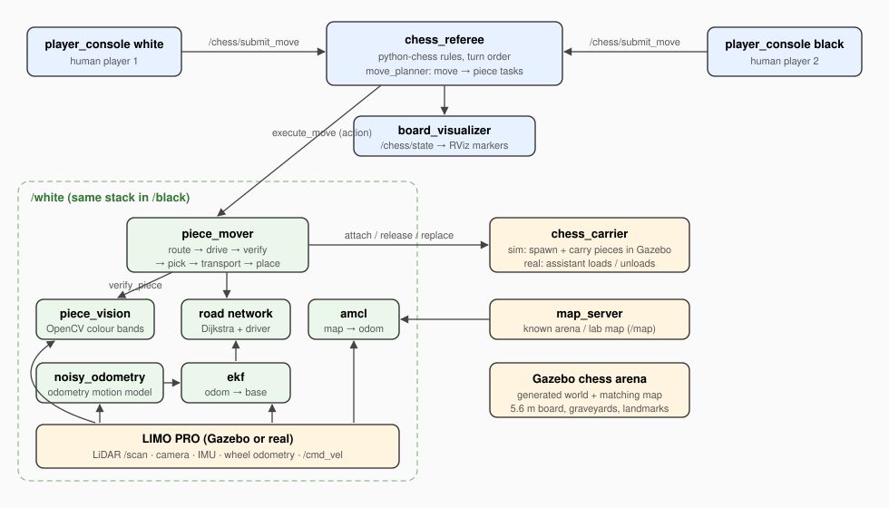

# LIMO Robot Chess

Two AgileX **LIMO PRO** robots play chess on a giant floor chessboard.
Each side of the board belongs to a human player who decides the moves; the
player's robot then executes every move physically. It navigates on its own to
the piece, checks it with the on-board camera, carries it to the destination
square and takes captured pieces to a graveyard next to the board.

The system runs on ROS 1 Noetic. It works in Gazebo/RViz with two robots and
on a single real LIMO PRO in the laboratory.



## Features

| Module | Implementation |
|---|---|
| Chess rules | `python-chess`: legal moves, check, mate, stalemate, draws, castling, en passant, promotion |
| Move → robot tasks | `move_planner.py` splits a move into ordered pick-and-place tasks (capture first, rook after king, promotion swap) |
| Navigation | `move_base` with a Dijkstra global planner and a DWA local planner, tuned to drive along the 0.52 m lanes between pieces |
| Noisy motion model | `noisy_odometry.py`: odometry motion model (rot1, trans, rot2) applied to Gazebo's perfect odometry |
| Sensor fusion | `robot_localization` EKF fuses wheel odometry and IMU; AMCL fuses the LiDAR with the known map |
| Known initial pose | each robot starts at its known home pose; AMCL is initialised with it |
| Visual verification | colour-band piece code + OpenCV HSV classification, majority vote over 5 frames |
| Simulation | generated Gazebo arena + matching occupancy map, namespaced LIMO PRO model with noisy LiDAR, camera and IMU |
| Real robot | same stack on one LIMO PRO; the opponent's side is played by hand |

## Repository layout

```
robot_chess_msgs/         messages, services, ExecuteMove action
robot_chess_description/  namespaced LIMO PRO URDF (xacro) with Gazebo sensors
robot_chess_gazebo/       arena generator, world, piece spawner / simulated carrier
robot_chess_navigation/   noisy odometry, EKF, AMCL, move_base config, maps
robot_chess_game/         referee, player console, piece mover, vision, visualiser
                          + the ROS independent library (src/robot_chess) and its tests
robot_chess_bringup/      simulation.launch, real_robot.launch, RViz configs, smoke test
docs/                     system design document
```

## Installation (Ubuntu 20.04, ROS Noetic)

```bash
sudo apt install ros-noetic-desktop-full ros-noetic-navigation \
     ros-noetic-robot-localization ros-noetic-gmapping python3-pip
pip3 install chess

mkdir -p ~/chess_ws/src && cd ~/chess_ws/src
git clone https://github.com/MaryamMoh/limo-robot-chess.git
git clone https://github.com/agilexrobotics/limo_ros.git     # LIMO meshes / drivers
cd ~/chess_ws
rosdep install --from-paths src --ignore-src -r -y
catkin_make
source devel/setup.bash
```

On the LIMO PRO itself, `limo_ros` is already installed in `~/agilex_ws`.
Clone only this repository and build it in the same or an overlaying workspace.

## Playing in simulation

```bash
roslaunch robot_chess_bringup simulation.launch          # Gazebo + RViz + everything
```

Then each player opens their own terminal. Any computer connected to the same
ROS master works (`export ROS_MASTER_URI=http://<host>:11311`).

```bash
rosrun robot_chess_game player_console.py white          # player 1
rosrun robot_chess_game player_console.py black          # player 2
```

```
    a  b  c  d  e  f  g  h
  +-------------------------+
8 | r  n  b  q  k  b  n  r |
7 | p  p  p  p  p  p  p  p |
...
white> e4
OK: e4 accepted, robot is moving
  * [white robot] approach: e2 via (0.35, -1.33) [candidate 1]
  * [white robot] verify: OK: saw white pawn in 5/5 frames (expected white pawn)
  * [white robot] pick: white_pawn_e
  ...
```

Console commands: a move in SAN (`Nf3`, `exd5`, `O-O`, `e8=Q`) or UCI (`g1f3`),
`moves`, `board`, `history`, `draw`, `resign`, `help`, `quit`.

Useful options: `gui:=false` (headless Gazebo), `rviz:=false`.
A new game: `rosservice call /chess/new_game` and `rosservice call /chess_carrier/reset`.

### What happens during a move

1. The console sends the move to the **referee** (`/chess/submit_move`), which checks it is legal and that it is that player's turn.
2. The referee turns the move into **piece tasks** and sends them to the player's robot (`/<color>/execute_move`).
3. For every task the **piece mover**:
   - picks a free **approach pose** next to the piece and drives there with move_base (it tries the next candidate if one fails);
   - turns to face the piece and asks the **camera** to confirm its colour and type;
   - **picks** the piece up, drives to the destination, **places** it, and swaps the model on a promotion.
4. The robot returns to its home pose. The referee commits the move, detects check, mate or draw, and hands the turn to the opponent.

## Board geometry

The board has 8 × 0.7 m squares (5.6 m) and the pieces stand on the square
centres (0.18 m diameter). This leaves 0.52 m free lanes along all square
edges, more than twice the LIMO width. Standing on a square corner is always
collision free, so **any piece can be reached however crowded the board is**.
Captured white pieces go to the graveyard at x = −4.5 m and black ones to
x = +4.5 m.

Each piece wears a colour band at the height of the LIMO camera. The band
colour gives the piece type and the body colour gives the side:

| type | pawn | knight | bishop | rook | queen | king |
|---|---|---|---|---|---|---|
| band | green | blue | yellow | red | magenta | cyan |

The arena world and its occupancy map are generated from one description:

```bash
python3 robot_chess_gazebo/scripts/generate_arena.py
```

## Real LIMO PRO deployment

The robot plays one side; the human opponent moves their own pieces by hand and
types their moves in the console. The LIMO has no arm, so at each piece the robot
stops, verifies it with the camera, and asks an assistant to load or unload it.

1. Tape an 8 × 8 board with 0.5 m squares on the floor. Mark the pieces with
   the colour bands above.
2. Start the drivers on the robot:
   ```bash
   roslaunch limo_bringup limo_start.launch pub_odom_tf:=false
   roslaunch astra_camera dabai_u3.launch
   ```
3. Map the laboratory once:
   ```bash
   roslaunch robot_chess_navigation gmapping.launch
   roslaunch limo_bringup limo_teletop_keyboard.launch     # drive around
   rosrun map_server map_saver -f $(rospack find robot_chess_navigation)/maps/lab
   ```
4. Enter the board centre and orientation in the map in
   `robot_chess_game/config/board_real.yaml`.
5. Place the robot on its home pose and start the game:
   ```bash
   roslaunch robot_chess_bringup real_robot.launch color:=white rviz:=true
   rosrun robot_chess_game player_console.py white     # robot's side
   rosrun robot_chess_game player_console.py black     # human opponent
   ```
6. When the robot asks for help (`/chess/operator_instructions`), load or unload the piece and confirm:
   `rosservice call /chess_carrier/confirm`

If the Dabai publishes its colour image under a different name, pass it with
`image_topic:=...`.

## Tests

```bash
cd robot_chess_game && PYTHONPATH=src python3 -m pytest -q test      # unit tests
roslaunch robot_chess_bringup simulation.launch gui:=false rviz:=false &
rosrun robot_chess_bringup smoke_test.py                             # end-to-end game
```

GitHub Actions runs the unit tests, builds the workspace in a ROS Noetic
container, and plays `1. e4 e5 2. Nf3` with both robots in headless Gazebo.

## Known limitations

- A move is committed only when the robot finishes it. If navigation fails
  halfway, the referee reports the error and the same move can be submitted again
  after fixing the board.
- Simulated picking is a "virtual gripper": the piece is placed on the
  robot's carrying plate. On the real robot an assistant does it.
- Underpromotion needs a spare piece of that type next to the board on the real robot.

See [docs/system_design.md](docs/system_design.md) for the full design.
