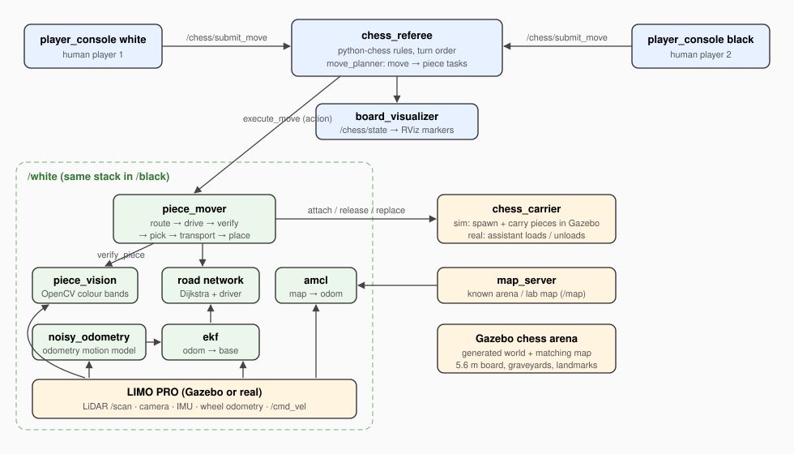

# System Design: LIMO Robot Chess

## 1. Goal

Two AgileX LIMO PRO robots play a game of chess on a floor chessboard. Each
robot belongs to one human player:

- the human chooses the move;
- the robot executes it physically, fully autonomously: it plans, navigates,
  localises, verifies the piece with its camera, and carries it.

The system is developed and tested in Gazebo/RViz with two robots, and deployed
on a single real LIMO PRO in the laboratory.

## 2. Hardware and software platform

| Item | Used for |
|---|---|
| AgileX LIMO PRO, four-wheel differential mode | mobile base, in-place rotation, max ~0.35 m/s used |
| NVIDIA Orin Nano | runs the robot's nodes |
| EAI T-mini Pro LiDAR (`/scan`) | AMCL localisation, obstacle detection (pieces, other robot) |
| Orbbec Dabai depth camera (colour stream) | piece verification |
| IMU (`/imu`) | yaw rate for the EKF |
| Wheel odometry (`/odom`, `limo_base`) | EKF input |
| Ubuntu 20.04, ROS Noetic, Gazebo 11 | as on the LIMO PRO image |

The simulated robot (`robot_chess_description/urdf/limo_pro.urdf.xacro`)
reuses the geometry, masses, sensor placement and meshes of AgileX's
`limo_description`. Every frame and topic is prefixed with the robot name so
several robots can share one Gazebo world. The model adds noise to all
sensors:

- LiDAR: σ = 1.5 cm
- camera: σ = 0.01
- IMU: σ = 0.005

## 3. Architecture



| Node | Package | Role |
|---|---|---|
| `chess_referee` | game | chess rules, turn order, move decomposition, dispatch to robots, game state |
| `player_console` (×2) | game | one terminal per human player |
| `board_visualizer` | game | logical board as RViz markers |
| `piece_mover` (per robot) | game | `execute_move` action server: navigation + pick/place sequence |
| `piece_vision` (per robot) | game | `verify_piece` service: camera-based piece identification |
| `chess_carrier` | gazebo / game | sim: spawns pieces and carries them; real: asks an assistant |
| `noisy_odometry` (per robot, sim) | navigation | noisy motion model |
| `ekf` (per robot) | navigation | `robot_localization`: odometry + IMU fusion |
| `amcl` (per robot) | navigation | LiDAR localisation on the known map |
| `move_base` (per robot) | navigation | global (Dijkstra) and local (DWA) planning |
| `map_server` | navigation | known map of the arena / laboratory |

### Main interfaces (`robot_chess_msgs`)

- `SubmitMove.srv`: console → referee (`color`, `move` | `resign` | `draw`).
- `GameState.msg`: latched on `/chess/state` (FEN, turn, status, history, result).
- `ExecuteMove.action`: referee → robot, a list of `PieceTask`s plus the
  occupied squares, with feedback per stage.
- `PieceTask.msg`: one pick-and-place job (model, colour, type, from/to label
  and coordinates, optional promotion).
- `VerifyPiece.srv`: robot → camera.
- `AttachPiece` / `ReleasePiece` / `ReplacePiece`: robot → carrier.

### TF tree (per robot, simulation)

```
map ──amcl──> white/odom ──ekf──> white/base_footprint ──urdf──> white/base_link
                                                                  ├─ white/laser_link
                                                                  ├─ white/depth_camera_link ─ white/depth_link
                                                                  ├─ white/imu_link
                                                                  └─ white/carrier_plate, wheels
```

## 4. Modules

### 4.1 Chess logic and move decomposition

`python-chess` holds the logical position and decides legality, check, mate,
stalemate, insufficient material and the 75-move and fivefold-repetition rules.
Threefold repetition and the 50-move rule are applied when a player types `draw`.

Next to the logical board, the referee keeps a **physical state**: which model
stands on which square, and how many pieces lie in each graveyard.
`move_planner.plan_move()` turns a legal move into ordered tasks:

| Move | Tasks |
|---|---|
| quiet move | piece `from → to` |
| capture | victim `to → graveyard`, then piece `from → to` |
| en passant | victim (beside the pawn) `→ graveyard`, then pawn |
| castling | king `e → g/c`, then rook `h → f` / `a → d` |
| promotion | (capture), pawn `from → to`, then swap model for the new piece |

The referee commits the move only after the robot reports success. Physical
and logical state therefore never diverge silently.

### 4.2 Board geometry and approach poses

The board frame has its origin at the board centre, x pointing a→h and y
pointing 1→8. It is placed in the map frame by `(origin_x, origin_y, yaw)`,
so the same code serves the simulated arena and a taped laboratory board.

With 0.7 m squares and 0.18 m pieces on the square centres, the square edges
form 0.52 m lanes. The LIMO is 0.22 m wide.
`BoardGeometry.approach_poses()` produces up to eight candidate poses around a
target:

- 4 *orthogonal* poses, 0.42 m from the piece, facing it. Valid only if the
  neighbouring square in that direction is empty.
- 4 *diagonal* poses, exactly on the square corners (0.495 m). A corner is
  ≥ 0.495 m from all four surrounding piece centres, more than the needed
  clearance of 0.34 m (robot circumscribed radius 0.20 + piece radius 0.09 +
  margin 0.05). The robot can always stand on a corner, so every square can
  be reached however crowded the board is.

Candidates are sorted: orthogonal first (the camera gets closer), then by
distance from the robot. If move_base fails, the piece mover tries the next
candidate.

### 4.3 Navigation (autonomous, noisy motion)

- **Global planner:** `global_planner` (Dijkstra) on a costmap made of the
  static map, LiDAR obstacles and inflation. The inflation is 0.30 m with a
  steep decay (factor 8), so the lanes between pieces stay traversable.
- **Local planner:** DWA. Speed is limited to 0.35 m/s and 1.2 rad/s. The goal
  tolerance is 8 cm / 0.15 rad; after arrival the robot rotates in place to
  face the piece exactly (P-controller on the bearing error).
- After placing a piece the robot backs off 12 cm, so the next approach starts
  clear of the piece. After the move it returns to its home pose beside the
  board.
- Pieces are not in the map. They are seen by the LiDAR (all pieces are
  ≥ 0.32 m tall, the scan plane is at 0.12 m). A carried piece sits on the top
  plate, above the scan plane and outside the camera view.

**Noisy motion model.** Gazebo's drive plugin reports perfect odometry.
`noisy_odometry.py` applies the odometry motion model (Thrun et al.,
*Probabilistic Robotics*, §5.4) to each increment. The increment is split into
rot1, trans and rot2, and each part gets zero-mean Gaussian noise. We use
variances proportional to the absolute increments, not their squares:

```
var(rot1)  = a1·|rot1|  + a2·|trans|
var(trans) = a3·|trans| + a4·(|rot1| + |rot2|)
var(rot2)  = a1·|rot2|  + a2·|trans|
```

This makes the error grow like a random walk with distance travelled and
keeps it independent of the 50 Hz update rate. The unit tests check that the
error is similar at different rates.

### 4.4 Sensor fusion and localisation (known initial pose)

1. **EKF** (`robot_localization`, 2D mode) fuses the noisy wheel odometry
   (vx, vyaw) and the IMU yaw rate. It publishes `odom → base_footprint`.
2. **AMCL** (likelihood-field laser model, 300–2000 particles) corrects the
   drift against the known map. It publishes `map → odom`.
   - It is initialised with the robot's **known home pose** (σ = 0.1 m).
   - Because the pieces are not in the map, `z_rand = 0.2` accounts for
     unexpected obstacles.
   - The arena has four different corner landmarks, so its square shape cannot
     cause an ambiguous localisation.

### 4.5 Map

- **Simulation:** `generate_arena.py` writes the Gazebo world and the occupancy
  grid (0.05 m/cell) from the same geometric description, so the map and the
  world match exactly. CI checks that the committed files are up to date.
- **Real robot:** the laboratory is mapped once with `gmapping`
  (`robot_chess_navigation/gmapping.launch`). The board position in that map
  is entered in `board_real.yaml`.

### 4.6 Visual piece verification

Each piece carries a saturated colour band at the camera height (0.12–0.24 m).
The band colour encodes the type; the hues are 60° apart. The body colour
(white or black) encodes the side. `robot_chess.vision.detect_piece()` runs
these steps:

1. take the central vertical strip of the image (the robot faces the piece);
2. threshold in HSV (S ≥ 110, V ≥ 60), then apply a morphological opening;
3. take the largest connected component as the band;
4. compute the circular mean hue and assign the nearest type hue
   (confidence = 1 − distance/15);
5. take the median brightness of the low-saturation pixels just below the band
   to decide white or black.

The `piece_vision` node classifies 5 consecutive frames and returns the
majority vote. A mismatch is reported in the event log. With
`abort_on_mismatch` set, the move stops instead.

### 4.7 Carrying pieces

The LIMO PRO has no manipulator. The `chess_carrier` interface hides how a
piece is moved:

- **Simulation:** the piece model is set onto the robot's carrying plate and
  follows the robot at 30 Hz until it is released on the target square.
- **Real robot:** `manual_carrier.py` publishes an instruction for a lab
  assistant ("put the WHITE PAWN on the robot") and waits for
  `rosservice call /chess_carrier/confirm`.

The piece mover is identical in both cases.

### 4.8 Two players, two robots

- The robots wait at home poses south and north of the board, so they never
  block each other.
- Only the robot of the side to move drives.
- The referee rejects moves out of turn and moves while a robot is busy.
- Consoles can run on any machine on the same ROS master.

On the real robot only one side has a robot. The other side is configured as
*virtual*: its moves are typed into the console and the human moves the piece by
hand.

## 5. Simulation environment

| Element | Size / position |
|---|---|
| walled arena | 11 m × 11 m, 0.6 m walls |
| chessboard | 8 × 0.7 m = 5.6 m, centred at the origin |
| graveyards | x = −4.5 m (white pieces) / +4.5 m (black pieces), 15 slots each |
| home poses | white (0, −3.9) facing north, black (0, 3.9) facing south |
| landmarks | box, cylinder, cylinder pair and rotated box in the corners; two wall stubs |
| pieces | 32 static models, spawned at runtime, 0.32–0.48 m tall |

## 6. Testing

- **Unit tests** (`robot_chess_game/test`, pytest, 41 tests):
  - geometry: round trips, rotated boards, graveyards, reachability of every
    piece on full boards;
  - move planning: captures, en passant, both castlings, promotion with
    capture, a full game;
  - vision: every type and colour on synthetic noisy images;
  - noise model: zero-noise exactness, accumulation, rate independence,
    backward motion;
  - SDF validity.
- **Integration test** (`robot_chess_bringup/scripts/smoke_test.py`):
  - starts the full two-robot simulation headless and plays `1. e4 e5 2. Nf3`
    through the referee;
  - checks every piece's final pose in Gazebo (< 5 cm) and that the camera
    recognised every piece.
- GitHub Actions runs both on every push, the second inside the
  `osrf/ros:noetic-desktop-full` container.

## 7. Real robot deployment

See README, section *Real LIMO PRO deployment*. In short:

1. drivers;
2. gmapping;
3. board pose in `board_real.yaml`;
4. `real_robot.launch color:=white`;
5. two consoles;
6. the assistant confirms load/unload.

The board uses 0.5 m squares, and the approach geometry is checked by the same
unit tests with the real configuration.

## 8. Limitations and possible extensions

- A failed move (for example blocked navigation) is not rolled back
  physically. The referee reports it, and the player fixes the board and
  resubmits.
- Picking is virtual in simulation and manual on the real robot. A LIMO with
  the myCobot arm (`limo_cobot_sim`) could replace the carrier without changing
  the piece mover.
- Chess960 castling is not supported (standard chess only).
- A chess engine could be added as a third "player" for single-human games.
